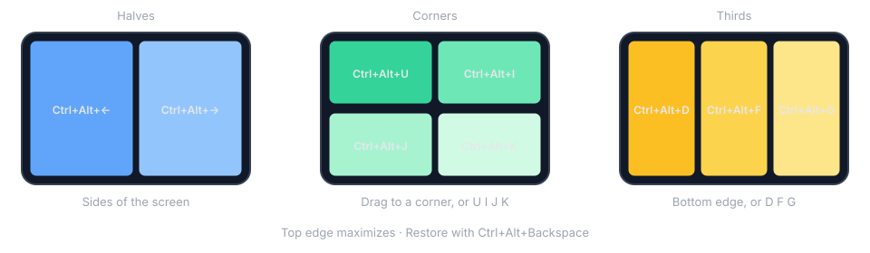
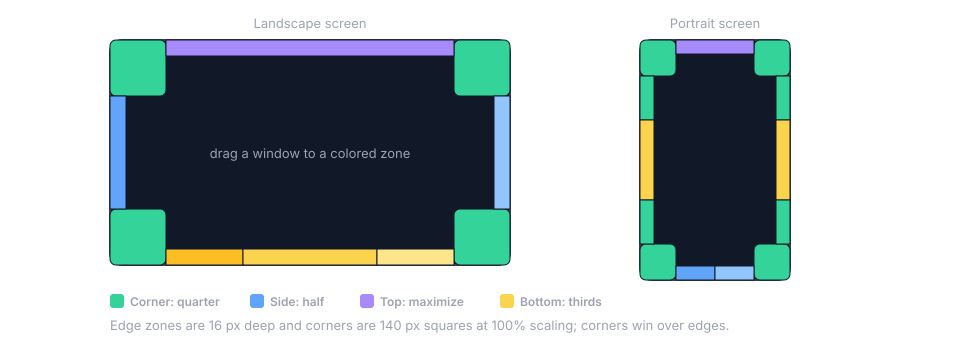

# Loadstone for Windows

<p align="center">
  <strong>Snap any window into place.</strong><br>
  Halves, corners, and thirds — from the keyboard or by dragging to an edge.<br>
  A native tray app. No browser engine, no background service.
</p>

<p align="center">
  
  
  
</p>

Loadstone sits in the tray and stays out of the way. When you need two documents side by side, a browser in a third, or a window parked in a corner, it moves the focused window to a precise tile of the display's work area — the taskbar is left uncovered. It is the Windows port of the [macOS Loadstone](https://github.com/mortenbrudvik/loadstone), with the same commands and the same defaults.

<p align="center">
  
</p>

## Features

- **Halves** — left, right, top, bottom
- **Corners** — four quarters
- **Thirds** — left, center, right, plus two-thirds
- **Maximize, center, restore** — restore puts the window back where it was before Loadstone first moved it. Settings → General → **Restore one move at a time** makes each press step back one move instead, including a drag snap
- **Drag to snap** — edges for halves, corners for quarters, top to maximize, bottom for thirds. Only a window that is actually being moved snaps; selecting text or resizing near an edge does nothing
- **Multi-display** — press left or right half again and the window carries on into the display beside it, one half at a time. Or send a window to the next or previous display, walking displays left to right as they sit on the desk: the window keeps the place and the proportion of the work area it had, so a half stays a half. That mapping is by pixel size, not DPI: on a display with the same pixel dimensions but heavier scaling, the window keeps its pixel size and so looks physically smaller
- **Custom shortcuts** — Magnet-style defaults, all editable, with a warning when a chord is taken by another app or types a character on your keyboard layout
- **Launch at login** — optional, from Settings

Drag snapping is off until you turn it on in Settings, because turning it on is what lets Loadstone switch off Windows' own drag-to-edge snapping while it runs, so the two don't fight; switching drag snapping back off, quitting, or signing out puts Windows' setting back. If Loadstone is killed before it can put the setting back, the next launch notices and restores it. The two flags it changes are the drag-to-edge ones, so Win+Arrow and Snap Layouts should be unaffected — but only drag drops were tried when this was measured, so neither is verified.

## Default shortcuts

All of these are Ctrl+Alt unless noted. Change them in **Settings → Shortcuts**.

| Layout | Shortcut |
| --- | --- |
| Left / right / top / bottom half | `Ctrl+Alt+←` `Ctrl+Alt+→` `Ctrl+Alt+↑` `Ctrl+Alt+↓` |
| Top left / top right corner | `Ctrl+Alt+U` `Ctrl+Alt+I` |
| Bottom left / bottom right corner | `Ctrl+Alt+J` `Ctrl+Alt+K` |
| Left / center / right third | `Ctrl+Alt+D` `Ctrl+Alt+F` `Ctrl+Alt+G` |
| Left / right two thirds | `Ctrl+Alt+E` `Ctrl+Alt+T` |
| Maximize | `Ctrl+Alt+Enter` |
| Center (keeps the current size) | `Ctrl+Alt+C` |
| Restore | `Ctrl+Alt+Backspace` |
| Next / previous display | `Ctrl+Alt+Win+→` `Ctrl+Alt+Win+←` |

The corner keys are a square on the keyboard:

```
U  I
J  K
```

Press `Ctrl+Alt+←` again on a window that is already in the left half and it moves on to the right half of the display to its left, so repeated presses walk it across your displays one half at a time. `Ctrl+Alt+→` does the same to the right. At the outer edge of the desk the window stays put, and a display above or below does not count.

On Norwegian, German, and most other European layouts, AltGr is Ctrl+Alt to Windows, so `Ctrl+Alt+E` also captures the `€` key while Loadstone runs. Settings shows "Types € on your keyboard layout" next to any such binding; rebind it if you type that character.

## Drag to snap

Drag a window by its title bar until the pointer reaches an edge or corner of the display. A preview in the system accent color shows the tile; let go to snap. Only a window that is actually moving snaps, so selecting text or dragging a slider to an edge does nothing.

<p align="center">
  
</p>

- **Corners** — a quarter. The corner zones are 140 px squares (scaled with the display) and win over the edges.
- **Left and right edges** — a half.
- **Top edge** — maximize.
- **Bottom edge** — a third, chosen by where along the edge you let go.
- **Portrait displays** — the sides give corner, vertical third, corner along their length, and the bottom edge gives halves.
- **More than one display** — every display has its own zones, including the edge it shares with a neighbor. The pointer does not stop at a shared edge the way it does at an outer one, so slow down there and let go while the preview is showing. The window snaps onto the display the pointer is on.

The edge zones are 16 px deep at 100% scaling and extend the same distance past an outer edge, so overshooting still counts.

## Install

Loadstone is meant to be installed from the Microsoft Store; no listing is live yet. Once it is, the Store installs it for the current user, no administrator rights needed, onto Windows 10 20H2 (build 19041) or later, x64 — the package manifest declares that floor directly (`TargetDeviceFamily MinVersion="10.0.19041.0"`), not the `net10.0-windows10.0.26100.0` target framework, which only sets the baseline the platform-compatibility analyzer checks against and is not itself a version floor. Nothing in the app calls an API newer than Windows 10. Development and testing have all been on Windows 11, so Windows 10 is declared rather than verified.

**Beta builds.** Before the Store listing is live, Loadstone is handed out as a `Setup.exe` built
from this repository. It installs for the current user with no administrator rights, onto the same
Windows floor the Store package declares (build 19041 or later, x64). It is unsigned, so SmartScreen
warns on first run — see [docs/beta-testing.md](docs/beta-testing.md), which is the page to give a
tester along with the installer.

Optional: **Settings → Launch at login**.

### Build from source

You need the [.NET 10 SDK](https://dotnet.microsoft.com/download). Once the repository is published:

```powershell
git clone https://github.com/mortenbrudvik/loadstone-win.git
cd loadstone-win
dotnet build Loadstone.slnx
dotnet run --project src/Loadstone.UI
```

To build the beta installer you also need [Inno Setup](https://jrsoftware.org/isinfo.php) 6.3 or
newer (`winget install --id JRSoftware.InnoSetup`):

```powershell
& 'C:\Program Files\PowerShell\7\pwsh.exe' -File build/build-installer.ps1
```

It writes `installer-output/Loadstone-<version>-Setup.exe`. The installer is unsigned; signing needs
a purchased certificate and is not planned for the beta channel.

## Troubleshooting

Tray → Loadstone → **Loadstone Help** opens <https://mortenbrudvik.github.io/loadstone-site/help/>, which carries the shortcuts, the drag zones and this troubleshooting list. That page is public even while this repository is not.

**One window will not move.** Windows of programs running as administrator cannot be moved by a program that isn't, and some windows are fixed-size. Loadstone beeps and logs the refusal; everything else keeps working. Fixed-size windows are centered in the tile instead of resized.

**A shortcut does nothing.** Check the Shortcuts tab: a chord held by another app is captioned "In use by another app". Close that app or rebind the chord. Graphics-driver utilities and file-manager tools commonly hold Ctrl+Alt+arrow chords, so they are the usual culprit. If the row instead says "Types € on your keyboard layout", the chord doubles as an AltGr character on your layout and captures it while Loadstone runs; rebind if you need the character.

**Dragging to an edge does not snap.** Drag by the title bar; the window has to move before Loadstone treats the gesture as a window drag. On the edge between two displays the pointer passes straight through, so slow down and release while the preview is showing. If Windows' own Snap Layouts flyout appears at the top edge, turn it off under Settings → System → Multitasking → Snap windows.

**Restore does nothing.** Restore remembers where the window was before Loadstone moved it, then forgets once that place is restored. By default that is one jump back to the original spot. With **Restore one move at a time** on (Settings → General), each press steps back one move until that same spot, and then it forgets. The next Loadstone command starts a new memory. The memory is also dropped when the window closes or Loadstone restarts.

**Next / previous display beeps.** Only one display is attached.

**Pressing `Ctrl+Alt+←` again does not move the window to the display beside it.** Only a display to the side counts, as arranged in Settings → System → Display; one above or below does not. And the window has to be in that half already: if you have moved it since, or the display's resolution has changed, the first press puts it back into the half.

**Windows' own edge snapping is off after Loadstone crashed or was killed.** Loadstone turns it off while its drag snapping is on and back on when it quits normally; after an unclean exit, simply launching Loadstone again restores it. Signing out and back in restores it too.

**Launch at login is on but Loadstone does not start.** Task Manager → Startup apps may have it disabled; Settings shows "Disabled in Task Manager" with a button to open that page.

**Reading the log.** Loadstone writes daily logs to `%LOCALAPPDATA%\Loadstone\Logs`, the same path whether run from source or installed from the Store — the package does not redirect file-system writes, only the registry. Settings → General → **Open log folder** opens it directly, which is worth using anyway: it resolves the path for you rather than making you type it. The startup summary lists the effective binding and status of every shortcut.

## Build and test

```powershell
dotnet build Loadstone.slnx                                   # warnings are errors
dotnet test --solution Loadstone.slnx                         # every test project
dotnet test --project tests/Loadstone.Core.Tests/Loadstone.Core.Tests.csproj
dotnet test --project tests/Loadstone.UI.Tests/Loadstone.UI.Tests.csproj --filter-query "/*/*/Win32WindowTests/*"
& 'C:\Program Files\PowerShell\7\pwsh.exe' -File tools/icons/generate.ps1   # regenerate the .ico assets
```

`global.json` opts the repo into the Microsoft.Testing.Platform runner (xunit.v3), so a positional `dotnet test Loadstone.slnx` and `--logger` do not apply; use `--solution`/`--project` and `--report-trx`. Filtering still works: `--filter` takes VSTest syntax, and xunit.v3 adds `--filter-class`, `--filter-method`, `--filter-namespace`, `--filter-trait` and their `--filter-not-*` variants. Use one family per run — `--filter` cannot be combined with `--filter-query` or the simple filters.

## How it works

Loadstone is a tray-only WPF app. Shortcuts and drag gestures go to a small window director that:

1. Finds the window (the foreground window, or the one being dragged)
2. Reads its visible frame, which excludes Windows' invisible resize borders
3. Lays out a tile against the display's **work area**
4. Writes the frame, then writes it once more if the window resized itself on a display with a different DPI
5. Reports what the window answered: a refused write makes Loadstone beep and log

Drag snapping listens to Windows' own move-loop events instead of the mouse, so a text selection or a slider dragged to a screen edge is left alone, and the snap is applied after Windows has finished the drop.

## Name

A lodestone is a naturally magnetic rock. Loadstone is the window magnet.

## License

[MIT](LICENSE) © 2026 Morten Brudvik.
